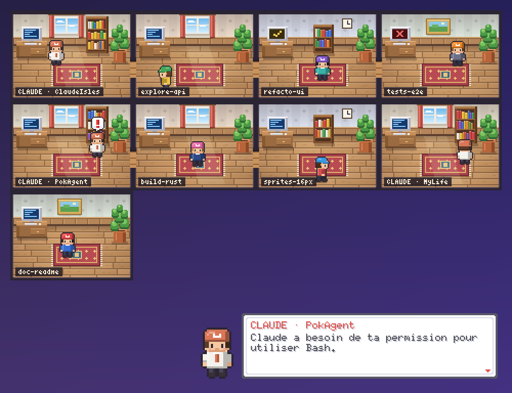
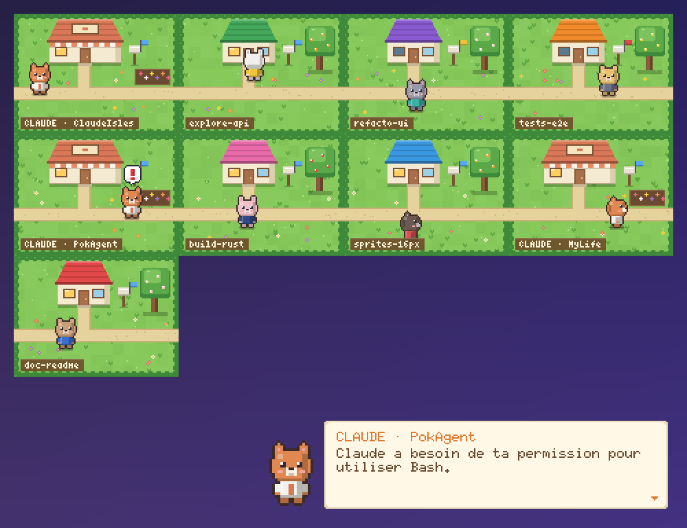
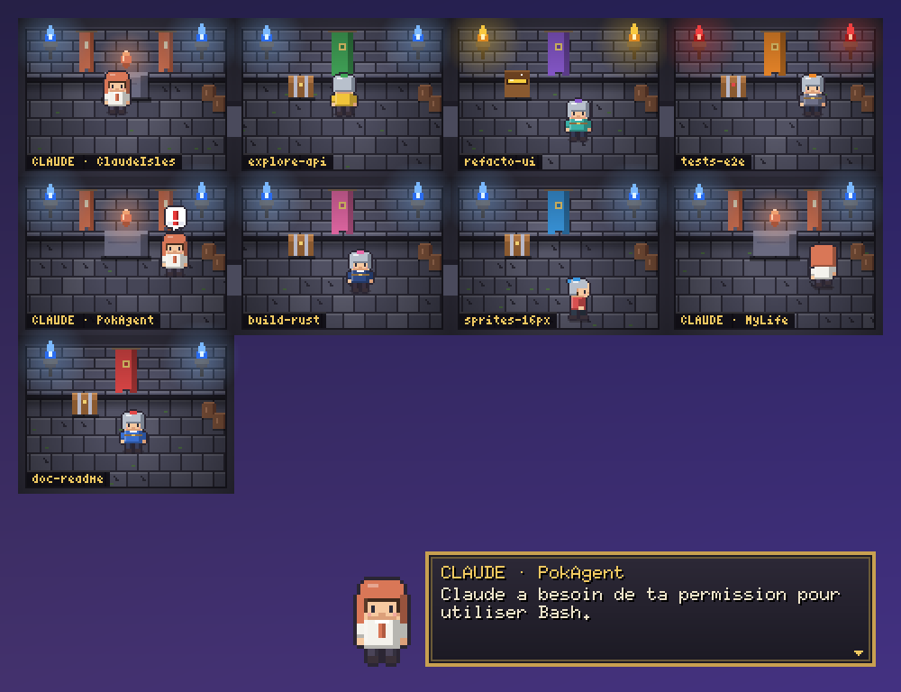

<p align="center"></p>

<h1 align="center">PokAgent</h1>

<p align="center">Ce que fait Claude Code sur ta machine, en pixel art, posé sur ton fond d'écran : une salle pour Claude, une salle pour chaque agent. Dans un labo de dresseurs, un village d'animaux ou un donjon.</p>

<p align="center">
  
  
  <a href="https://github.com/williamloree/PokAgent/releases/latest"></a>
  <a href="https://github.com/williamloree/PokAgent/actions/workflows/build.yml"></a>
  
</p>

<p align="center">Fait par William Loree.</p>


PokAgent lit en continu les journaux que Claude Code écrit déjà sur le disque et les met en scène dans le quart haut-gauche de ton écran principal, sous toutes tes fenêtres, juste au-dessus du fond d'écran. Quand une session attend ta réponse, son Claude passe au premier plan en bas à droite, avec un petit jingle.

Un seul exécutable de 750 Ko, en Rust, sans navigateur ni GPU : le dessin se fait sur le CPU en 480×270 pixels, agrandi ×2.

## Installer

1. Télécharge `pokagent.exe` depuis la [dernière release](https://github.com/williamloree/PokAgent/releases/latest).
2. Range-le où tu veux le garder (par exemple `%LOCALAPPDATA%\Programs\PokAgent\`), puis lance-le.

C'est tout. Au premier lancement, PokAgent s'inscrit pour démarrer avec Windows, puis se met à jour tout seul depuis les releases de ce dépôt.

| Mode | Commande |
|---|---|
| Normal | `pokagent.exe` |
| Démonstration (données fictives, rien n'est écrit) | `pokagent.exe --demo` |
| Mise à jour à la demande | `pokagent.exe update` |
| Ajouter le hook des questions à Claude Code | `pokagent.exe install-hook` |

Il faut Claude Code installé et Windows 10 ou 11.

## Ce que tu vois

| Dans la scène | Dans Claude Code |
|---|---|
| **La salle de Claude**, en blouse blanche et cravate orange | Une session Claude Code. Son écran défile tant que Claude travaille. |
| **Une salle** qui s'ouvre à côté, reliée par une porte | Un agent (outil `Agent`). Son dresseur fait des allers-retours entre la pièce et son PC. |
| **L'écran du PC** de la salle | Le statut : bleu en cours, or terminé (✓), rouge échec (✗). |
| **Une salle qui se ferme** | L'agent a fini depuis 2 minutes. |
| **Une bulle « ! »** au-dessus de Claude | La session attend ta réponse (question ou permission). |
| **Claude en grand, en bas à droite** | La question elle-même. Un clic ramène la fenêtre de la session (terminal, VS Code…) et ferme la bulle. |
| **« +N hors cadre »** | Plus de 12 salles : les suivantes ne s'affichent pas. |

Rien ne se dessine quand une application plein écran est au premier plan.

## Univers

Trois univers, au choix dans le menu de l'icône. Ils racontent la même chose avec leurs propres objets ; les couleurs de statut ne changent pas.

| | | |
|---|---|---|
|  <br> **Labo** <br> Dresseurs de monstres de poche, intérieur façon DS. Le statut s'affiche sur l'écran du PC. |  <br> **Village** <br> Une maison par agent sur une île, habitants animaux, Claude en renard. Le statut est sur le drapeau de la boîte aux lettres. |  <br> **Donjon** <br> Aventure vue de dessus : chevaliers, Claude en mage. Le statut est dans la couleur des torches ; le coffre s'ouvre quand l'agent a fini. |

Les dessins sont originaux, dans l'esprit de ces genres de jeux.

## Menu de l'icône

Clic sur l'icône PokAgent dans la zone de notification :

| Entrée | Effet |
|---|---|
| Labo / Village / Donjon | Change d'univers, tout de suite. |
| 2, 8 ou 20 images par seconde | 8 par défaut. 2 suffit pour un fond d'écran très calme. |
| Son des questions | Jingle 8 bits quand une question arrive. |
| Installer le hook des questions… | Voir plus bas. |
| Lancer avec Windows | Activé au premier lancement. |
| Mises à jour automatiques / Rechercher une mise à jour | Voir plus bas. |

Les réglages sont dans `%APPDATA%\PokAgent\config.json`.

## Questions de Claude

Sans rien installer, PokAgent repère les questions posées avec `AskUserQuestion`. Pour être prévenu aussi des **demandes de permission**, et pour que le clic sur la bulle ramène la bonne fenêtre, installe le hook `Notification` de Claude Code (menu › « Installer le hook des questions… », ou `pokagent.exe install-hook`).

Le hook ajoute une entrée dans `%USERPROFILE%\.claude\settings.json`, après en avoir fait une copie dans `settings.json.bak`. À chaque notification, Claude Code lance `pokagent.exe hook`, qui dépose un petit fichier dans `%LOCALAPPDATA%\PokAgent\questions\`. Le message « Claude attend ta saisie », envoyé à chaque fin de tour, est ignoré. La bulle disparaît dès que la session écrit de nouveau dans son journal.

## Mises à jour

Une minute après le lancement, puis toutes les 6 heures, PokAgent consulte la dernière release de ce dépôt. Si elle est plus récente, il télécharge `pokagent.exe`, vérifie son empreinte SHA-256 (`pokagent.exe.sha256`), remplace son propre exécutable et redémarre. Désactivable dans le menu.

Pour publier une version : augmenter `version` dans `Cargo.toml` et pousser sur `main`. Le workflow `.github/workflows/build.yml` compile, teste et crée la release `vX.Y.Z` si elle n'existe pas encore.

## Comment ça marche

| Partie | Rôle |
|---|---|
| `src/watcher.rs` | Lit en continu les journaux de Claude Code : `~/.claude/projects/<projet>/<session>.jsonl` (sessions, agents, fins de tâches) et `…/<session>/subagents/agent-*.meta.json` (agents terminés). Portage du watcher de [ClaudeIsles](https://github.com/williamloree/ClaudeIsles), dans son propre fil, une fois par seconde. |
| `src/hook.rs` | Sous-commandes `hook` (appelée par Claude Code ; retrouve la fenêtre qui héberge la session en remontant les processus parents) et `install-hook`. |
| `src/scene.rs` | Salles rangées en grille 4 × 3, personnages qui se promènent, bulle de question, mode démo. |
| `src/themes.rs` | Les trois univers : décor de chaque salle (calculé une fois), indicateur de statut, porte, personnages. |
| `src/sprites.rs` | Personnages 16×24, humains et animaux, dessinés une fois par agent dans les 4 directions. |
| `src/gfx.rs` | Tampon de pixels et primitives : rectangles, dégradés, polygones, contours, texte bitmap. |
| `src/updater.rs` | Mise à jour depuis les releases GitHub, via WinHTTP et BCrypt (aucune dépendance en plus). |
| `src/autostart.rs` | Lancement avec Windows (clé `Run` du registre utilisateur). |
| `src/main.rs` | Fenêtres transparentes, icône de notification, son, boucle à cadence fixe. |

- Les sessions modifiées dans les 15 dernières minutes sont affichées ; au démarrage, les journaux des 3 dernières heures sont relus.
- Seuls les pixels qui changent d'une image à l'autre sont renvoyés à Windows.
- `cargo test shots -- --ignored` régénère les captures de ce README avec le vrai moteur de rendu.

## Ce que ça coûte

Mesuré à 8 images par seconde sur un écran 1920×1080 : environ **1 % d'un cœur** (0,06 % d'un processeur 16 fils) et **6 Mo** de mémoire privée.

## Sécurité

- Les journaux de Claude Code sont seulement lus, jamais modifiés.
- Seule connexion réseau : l'API GitHub publique de ce dépôt, pour les mises à jour. Un exécutable téléchargé n'est installé que si son empreinte SHA-256 correspond à celle de la release.
- `settings.json` n'est modifié que si tu installes le hook, avec une copie de sauvegarde. Le lancement avec Windows n'écrit que dans le registre de ton utilisateur (`HKCU`).
- Le widget laisse passer tous les clics ; seule la bulle de question en reçoit.

## Compiler

```
cargo build --release        # target\release\pokagent.exe
cargo test
```

## Limites connues

- Windows uniquement, écran principal uniquement.
- 12 salles au plus en même temps ; au-delà, « +N hors cadre ».
- Le widget est une fenêtre posée juste au-dessus du fond d'écran : il passe devant les icônes du bureau situées dans ce quart.
- Sans le hook, les demandes de permission ne sont pas détectées et le clic sur la bulle ne ramène aucune fenêtre.
- Avec Windows Terminal, le clic ramène la fenêtre, pas forcément le bon onglet.
- La scène n'affiche que ce qui passe par les journaux : un agent lancé sur une autre machine n'apparaît pas.
